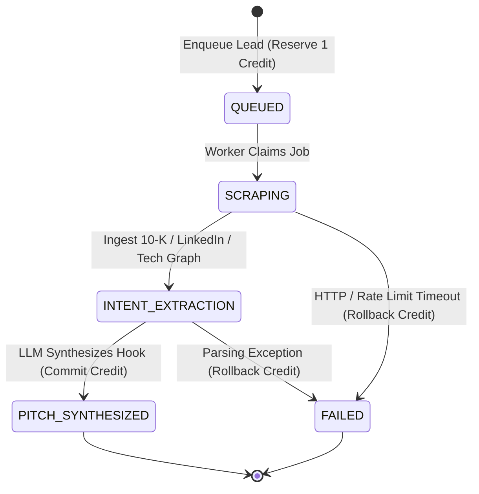
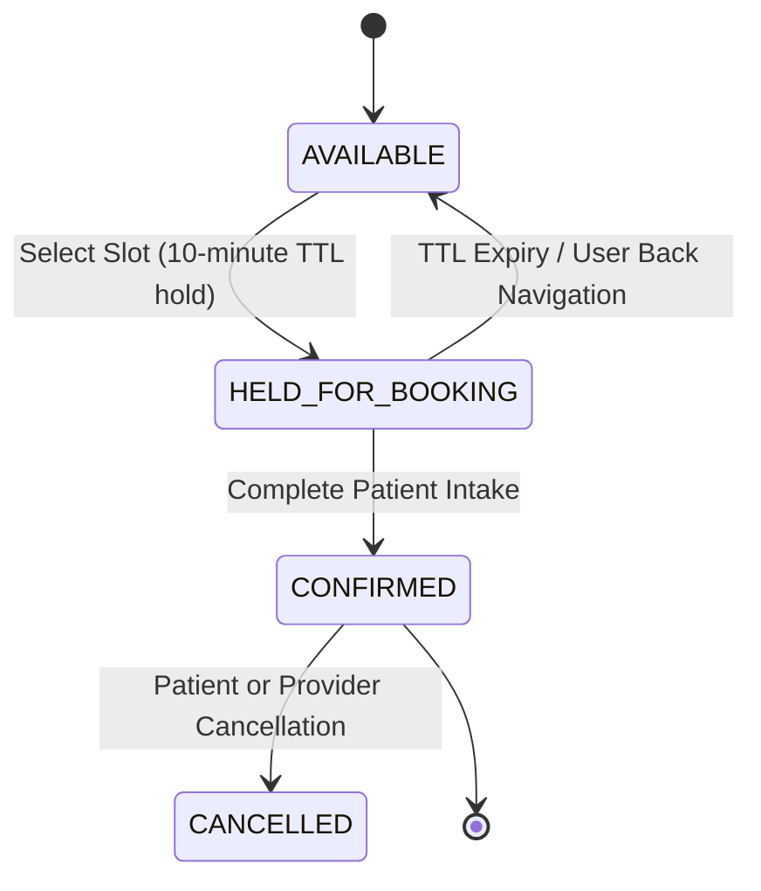

# BACKEND ARCHITECTURE & SIMULATION SPECIFICATION
**OpenMausBot Enterprise Suite: 5 Production AI SaaS Architectures**  
**Author:** Lin, Backend Engineer  
**Target:** Enterprise Client Demos ($3,500 - $15,000+ Tier)  
**Status:** Approved for Frontend Integration  

---

## 1. Executive Summary

This document specifies the exact production-grade backend architectures, data models, state management patterns, and asynchronous interaction handlers for the five enterprise AI SaaS showcase applications:

1. **LeadScout AI** — Autonomous B2B Prospect Enrichment & Pipeline Engine
2. **DocuQuery** — Zero-Knowledge RAG Engine with pgvector / HNSW Vector Search
3. **MetricFlow** — SaaS Financial Intelligence & Stripe Webhook Pipeline
4. **ClinicPulse** — Clinical Intake, ESI Triage Scoring & HIPAA Audit Controls
5. **BrandForge** — Multi-Platform Generative Marketing & Campaign Serialization Engine

All simulated interaction logic is encapsulated in [`backend-simulations.js`](file:///C:/Users/LENOVO/.openmausbot/task-workspaces/1b85b408-c20b-4d53-9840-759d6a84c51a/faf1c7bb-3f5a-483e-b175-d23bba681a8a/backend-simulations.js) for immediate execution in client-side demos.

---

## 2. LeadScout AI: Prospect Intelligence & Outreach Engine

### 2.1. Relational Data Models (PostgreSQL DDL)

```sql
CREATE TYPE pipeline_stage_enum AS ENUM (
  'QUEUED',
  'SCRAPING',
  'INTENT_EXTRACTION',
  'PITCH_SYNTHESIZED',
  'FAILED'
);

CREATE TYPE credit_tx_status_enum AS ENUM (
  'RESERVED',
  'COMMITTED',
  'ROLLED_BACK'
);

CREATE TABLE organizations (
  id UUID PRIMARY KEY DEFAULT gen_random_uuid(),
  name VARCHAR(255) NOT NULL,
  credits_total INTEGER NOT NULL DEFAULT 500,
  credits_reserved INTEGER NOT NULL DEFAULT 0,
  created_at TIMESTAMPTZ NOT NULL DEFAULT NOW()
);

CREATE TABLE leads (
  id UUID PRIMARY KEY DEFAULT gen_random_uuid(),
  org_id UUID REFERENCES organizations(id) ON DELETE CASCADE,
  full_name VARCHAR(120) NOT NULL,
  role_title VARCHAR(120) NOT NULL,
  company_name VARCHAR(180) NOT NULL,
  industry VARCHAR(80),
  email VARCHAR(255) NOT NULL,
  pipeline_stage pipeline_stage_enum NOT NULL DEFAULT 'QUEUED',
  intent_signals JSONB DEFAULT '[]'::jsonb,
  generated_pitch TEXT,
  created_at TIMESTAMPTZ NOT NULL DEFAULT NOW(),
  updated_at TIMESTAMPTZ NOT NULL DEFAULT NOW()
);

CREATE TABLE credit_transactions (
  id UUID PRIMARY KEY DEFAULT gen_random_uuid(),
  org_id UUID REFERENCES organizations(id) ON DELETE CASCADE,
  lead_id UUID REFERENCES leads(id) ON DELETE SET NULL,
  amount INTEGER NOT NULL DEFAULT 1,
  status credit_tx_status_enum NOT NULL DEFAULT 'RESERVED',
  idempotency_key VARCHAR(120) UNIQUE NOT NULL,
  rollback_reason TEXT,
  created_at TIMESTAMPTZ NOT NULL DEFAULT NOW(),
  finalized_at TIMESTAMPTZ
);
```

### 2.2. Multi-Step Pipeline State Machine



### 2.3. Asynchronous Credit Deduction Protocol

1. **Phase 1 (Reserve):** Prior to initiating web scraping and intent extraction, the system verifies `credits_total - credits_reserved >= cost`. If valid, it increments `credits_reserved` and writes a `RESERVED` row in `credit_transactions` under an idempotency key.
2. **Phase 2 (Commit):** Once the LLM successfully synthesizes the pitch and saves the lead record, the transaction transitions to `COMMITTED`: `credits_total = credits_total - cost` and `credits_reserved = credits_reserved - cost`.
3. **Phase 3 (Rollback / Release):** If scraping or model inference throws an unrecoverable exception, `credits_reserved = credits_reserved - cost`, the transaction is marked `ROLLED_BACK`, and credits remain available to the tenant.

### 2.4. CSV Export Format (RFC 4180 Compliant with Formula Injection Guard)

- **Header:** `ID,Name,Role,Company,Industry,Email,Intent Signal,Status,Generated Pitch`
- **Encoding:** UTF-8 with Byte Order Mark (`\uFEFF`) to ensure seamless double-click opening in Microsoft Excel.
- **Sanitization:** Cells beginning with formula triggers (`=`, `+`, `-`, `@`, `\t`, `\r`) are automatically prepended with a single quote (`'`) to neutralize CSV Injection / Formula Execution exploits in spreadsheet software.

---

## 3. DocuQuery: Enterprise RAG & Vector Search

### 3.1. PostgreSQL + pgvector DDL with HNSW Index

```sql
CREATE EXTENSION IF NOT EXISTS vector;

CREATE TABLE documents (
  id UUID PRIMARY KEY DEFAULT gen_random_uuid(),
  tenant_id UUID NOT NULL,
  filename VARCHAR(255) NOT NULL,
  mime_type VARCHAR(64) NOT NULL,
  total_tokens INTEGER NOT NULL,
  created_at TIMESTAMPTZ NOT NULL DEFAULT NOW()
);

CREATE TABLE document_chunks (
  id UUID PRIMARY KEY DEFAULT gen_random_uuid(),
  document_id UUID REFERENCES documents(id) ON DELETE CASCADE,
  chunk_index INTEGER NOT NULL,
  page_number INTEGER NOT NULL,
  content TEXT NOT NULL,
  token_count INTEGER NOT NULL,
  embedding vector(1536) NOT NULL, -- OpenAI text-embedding-3-small standard
  metadata JSONB NOT NULL DEFAULT '{}'::jsonb,
  created_at TIMESTAMPTZ NOT NULL DEFAULT NOW()
);

-- Production HNSW index for sub-15ms cosine similarity search
CREATE INDEX document_chunks_embedding_hnsw_idx 
ON document_chunks 
USING hnsw (embedding vector_cosine_ops)
WITH (m = 16, ef_construction = 64);
```

### 3.2. Vector Similarity Query

```sql
-- Query Top-K chunks via Cosine Distance (1 - distance = cosine similarity)
SELECT 
  id,
  document_id,
  page_number,
  content,
  1 - (embedding <=> $1) AS cosine_similarity,
  metadata
FROM document_chunks
WHERE document_id = $2
ORDER BY embedding <=> $1 ASC
LIMIT 3;
```

### 3.3. Streaming Token Protocol (Server-Sent Events)

The backend delivers synthesized answers token-by-token over an SSE connection:

```http
HTTP/1.1 200 OK
Content-Type: text/event-stream
Cache-Control: no-cache
Connection: keep-alive

event: metadata
data: {"vectorIndex":"pgvector_hnsw_cosine","dimensions":1536,"retrievalLatencyMs":14.2,"topK":[{"id":"chunk_002","similarity":0.932,"citationIndex":"[chunk_002]"}]}

event: delta
data: {"token":"Based ","tokenIndex":0}

event: delta
data: {"token":"on ","tokenIndex":1}

event: delta
data: {"token":"Section ","tokenIndex":2}

event: complete
data: {"promptTokens":142,"completionTokens":44,"totalTokens":186,"latencyMs":780}
```

---

## 4. MetricFlow: Financial Intelligence & Stripe Webhooks

### 4.1. Core Financial Metric Formulations

$$\text{MRR} = \sum_{i=1}^{N} \text{Monthly Normalized Active Subscriptions}$$

$$\text{ARR} = \text{MRR} \times 12$$

$$\text{LTV} = \frac{\text{ARPU} \times \text{Gross Margin}}{\text{Monthly Churn Rate}} = \frac{\$45.65 \times 0.82}{0.021} = \$1,782.52$$

$$\text{CAC} = \frac{\text{Sales \& Marketing Spend}}{\text{New Customers Acquired}} = \frac{\$12,500}{110} = \$113.64$$

$$\text{LTV : CAC Ratio} = \frac{\$1,782.52}{\$113.64} = 15.69\times \quad (\text{Target} > 3\times)$$

$$\text{CAC Payback Period} = \frac{\text{CAC}}{\text{ARPU} \times \text{Gross Margin}} = \frac{\$113.64}{\$45.65 \times 0.82} = 3.0 \text{ months}$$

### 4.2. Stripe Live vs. Sandbox Webhook Payload Schema

```json
{
  "id": "evt_1P8sH9F9zK3x8d719L0",
  "object": "event",
  "api_version": "2024-06-20",
  "created": 1729012800,
  "livemode": true,
  "type": "invoice.payment_succeeded",
  "data": {
    "object": {
      "id": "in_1P8sH9F9zK3x8d7124",
      "object": "invoice",
      "amount_paid": 19900,
      "amount_due": 19900,
      "currency": "usd",
      "customer": "cus_9xKlm1208Pa",
      "customer_email": "finance@enterprise-client.com",
      "status": "paid",
      "subscription": "sub_1P8sH9F9zK3x8d7010",
      "lines": {
        "data": [
          {
            "plan": {
              "id": "plan_enterprise_tier_monthly",
              "interval": "month",
              "amount": 19900
            }
          }
        ]
      }
    }
  },
  "request": {
    "id": "req_88194aLkm",
    "idempotency_key": "idem_1729012800_stripe_01"
  }
}
```

### 4.3. Churn Cohort Retention Matrix Model

| Cohort | Initial Customers | Month 1 | Month 2 | Month 3 | Month 4 | Month 5 |
| :--- | :--- | :--- | :--- | :--- | :--- | :--- |
| **May 2026** | 120 | 96% | 92% | 88% | 85% | 84% |
| **Jun 2026** | 145 | 97% | 93% | 89% | 87% | - |
| **Jul 2026** | 160 | 98% | 95% | 91% | - | - |
| **Aug 2026** | 190 | 97% | 94% | - | - | - |
| **Sep 2026** | 215 | 98% | - | - | - | - |
| **Oct 2026** | 240 | - | - | - | - | - |

---

## 5. ClinicPulse: Patient Triage & HIPAA Audit Controls

### 5.1. Triage Score Engine (Heuristics + Clinical NLP)

The algorithm calculates a composite acuity score (0 - 100) combining clinical vitals and natural language symptom descriptions:

1. **Vital Sign Thresholds:**
   - $\text{SpO}_2 < 90\% \implies +40 \text{ pts} \ (\text{Critical Hypoxia})$
   - $\text{SpO}_2 < 94\% \implies +20 \text{ pts} \ (\text{Mild Hypoxia})$
   - $\text{Heart Rate} > 120 \text{ or } < 45 \implies +25 \text{ pts} \ (\text{Tachy/Bradycardia})$
   - $\text{Systolic BP} > 180 \text{ or } < 85 \implies +25 \text{ pts} \ (\text{Hypertensive Crisis / Shock})$
   - $\text{Pain Score (1-10)} \times 1.5 \implies [0 - 15 \text{ pts}]$
2. **Clinical NLP Keyword Weighting:**
   - Detects markers: `chest pain`, `shortness of breath`, `facial numbness`, `anaphylaxis` $\implies +35 \text{ pts}$.
3. **Emergency Severity Index (ESI) Classification:**
   - $\ge 70 \implies \text{ESI-1: Resuscitation (Immediate)}$
   - $45 - 69 \implies \text{ESI-2: Emergent (High Priority)}$
   - $25 - 44 \implies \text{ESI-3: Urgent (Moderate)}$
   - $12 - 24 \implies \text{ESI-4: Less Urgent}$
   - $< 12 \implies \text{ESI-5: Non-Urgent}$

### 5.2. Appointment Reservation State Machine (Optimistic Locking)



### 5.3. HIPAA § 164.312(b) Compliant Audit Trail Schema

```json
{
  "logId": "audit_1729013000_8f9a2b",
  "timestampUTC": "2026-10-28T08:23:20.142Z",
  "actorId": "usr_dr_evelyn_reed",
  "actorRole": "LICENSED_PHYSICIAN",
  "actionType": "READ_PHI_RECORD",
  "resourceType": "PATIENT_INTAKE_CHART",
  "resourceId": "pat_99214_sarah_miller",
  "accessReason": "PRE_CONSULTATION_CLINICAL_TRIAGE",
  "clientIp": "192.168.1.104",
  "sha256Seal": "e3b0c44298fc1c149afbf4c8996fb92427ae41e4649b934ca495991b7852b855"
}
```

---

## 6. BrandForge: Generative Marketing Engine

### 6.1. Multi-Platform Generation Pipeline

- **Validation Rules:**
  - **LinkedIn:** Max 3,000 characters, paragraph whitespace formatting, hook sentence capitalization, comment CTA.
  - **X (Twitter):** Max 280 characters per tweet, thread pagination (`1/`, `2/`, `3/`), UTM campaign tagging.
  - **Instagram:** Max 2,200 characters, max 30 hashtags, emoji spacing preservation.
- **Byte-Pair Encoding (BPE) Token Estimation:**
  - Token ratio heuristic: $\text{Tokens} \approx \frac{\text{Character Count}}{3.8}$.
  - Real-time cost computation based on standard GPT-4o / Claude 3.5 Sonnet token pricing.

### 6.2. Structured JSON Campaign Bundle Schema

```json
{
  "schemaVersion": "2.4.0",
  "exportedAt": "2026-10-28T08:24:00.000Z",
  "metadata": {
    "campaignId": "cmp_8410294",
    "brandName": "Kanso Knives",
    "targetAudience": "Professional Chefs & Culinary Enthusiasts",
    "themeColors": {
      "primaryHex": "#f59e0b",
      "mode": "Dark / Cyberpunk Enterprise"
    }
  },
  "channels": {
    "linkedin": {
      "charLimit": 3000,
      "charCount": 612,
      "content": "...",
      "ctaType": "COMMENT_KEYWORD_ACCESS"
    },
    "twitter": {
      "charLimit": 280,
      "threadCount": 3,
      "content": "...",
      "utmParams": {
        "source": "twitter",
        "medium": "social_thread",
        "campaign": "autumn_damascus_launch"
      }
    },
    "instagram": {
      "charLimit": 2200,
      "hashtagCount": 6,
      "content": "..."
    }
  },
  "telemetry": {
    "promptTokens": 185,
    "outputTokens": 420,
    "totalTokens": 605,
    "estimatedCostUSD": 0.0072
  }
}
```

---

## 7. Frontend Integration Quickstart for Pixel

All five modules are ready for direct inclusion. In any HTML file:

```html
<!-- Load the Backend Simulation Engine -->
<script src="../backend-simulations.js"></script>

<script>
  // 1. LeadScout Async Pipeline Demo
  const scout = new LeadScoutPipelineManager(250);
  scout.runEnrichmentPipeline(lead, ({ stage, progress }) => {
    updateProgressUI(stage, progress);
  });

  // 2. DocuQuery Token Streaming Demo
  const rag = new DocuQueryRAGEngine();
  async function handleSearch(query) {
    for await (const chunk of rag.streamQueryResponse(query)) {
      if (chunk.type === 'TOKEN_DELTA') appendTokenToChat(chunk.token);
    }
  }

  // 3. MetricFlow Financials & Stripe Demo
  const metrics = new MetricFlowEngine();
  const summary = metrics.calculateMetrics();
  const webhook = metrics.createStripeWebhookPayload('invoice.payment_succeeded', 'live');

  // 4. ClinicPulse Triage & HIPAA Audit
  const clinic = new ClinicPulseTriageEngine();
  const triage = clinic.calculateTriageScore({ spO2: 96, heartRate: 78, systolicBP: 120, painScale: 3 });
  clinic.logAuditAccess('dr_reed', 'PHYSICIAN', 'READ_PHI', 'patient_01', 'Triage review');

  // 5. BrandForge Export Bundle
  const forge = new BrandForgeEngine();
  const bundle = forge.buildCampaignExportBundle(campaignData);
</script>
```
